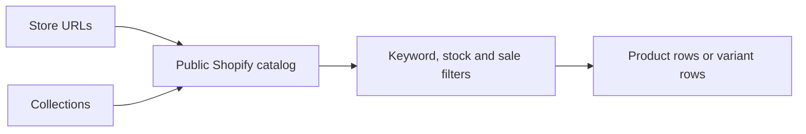

# Shopify Store Products Scraper: Prices, Stock and Variants

[](https://apify.com/Turboextract/shopify-store-products)
[](LICENSE)
[](#pricing)

**Export every product from any Shopify store: title, vendor, type, tags, price, compare-at price, sale flag, stock status, SKUs, variants, images and dates.** Filter by collection, keyword, stock and sale. It reads the store's public catalog, so there is no login, API key or browser.

In one test, the actor returned 300 products each from Allbirds and Gymshark, and flagged a non-Shopify site with a clear warning instead of failing.

**Try it now →** [apify.com/Turboextract/shopify-store-products](https://apify.com/Turboextract/shopify-store-products)

---

## Why this exists

- Shopify stores show prices and stock one product page at a time.
- Tracking competitor prices and discounts by hand does not scale past a few products.
- Price tracking tools charge monthly per store or per product.
- Many scrapers need a browser or proxies, which makes every run slow and costly.

---

## Who this is for

- **Ecommerce brands** tracking competitor prices, launches and discounts
- **Dropshippers and resellers** researching products, vendors and price points
- **Agencies** auditing a client's or prospect's catalog
- **Market researchers** comparing product ranges across stores
- **AI and data teams** building product datasets with real prices

---

## What you get

```json
{
  "store": "www.allbirds.com",
  "storeName": "Allbirds",
  "productId": 7205197709392,
  "title": "Men's Dasher NZ - Blizzard (Blizzard Sole)",
  "url": "https://www.allbirds.com/products/mens-dasher-nz-blizzard",
  "vendor": "Allbirds",
  "productType": "Shoes",
  "tags": ["category:Shoes", "..."],
  "currency": "USD",
  "price": 98,
  "maxPrice": 98,
  "compareAtPrice": 140,
  "onSale": true,
  "discountPercent": 30,
  "available": true,
  "variantCount": 13,
  "availableVariants": 12,
  "skus": ["A12445M080", "..."],
  "createdAt": "2025-08-06T20:03:38-07:00",
  "updatedAt": "2026-11-19T12:21:21-08:00",
  "imageUrl": "https://cdn.shopify.com/..."
}
```

Turn on **One row per variant** to get each size or color as its own row with its own SKU, price, stock and weight.

---

## How it works



---

## Quick start

1. Click **Try for free**.
2. Add **Stores**, like `allbirds.com` or `https://www.gymshark.com`. A collection URL works too.
3. Optional: add **Collections**, **Keywords**, or turn on **Only products on sale**.
4. Click **Start**, then export to CSV, JSON or Google Sheets.

### API

```bash
curl -X POST "https://api.apify.com/v2/acts/Turboextract~shopify-store-products/run-sync-get-dataset-items?token=YOUR_TOKEN" \
  -H "Content-Type: application/json" \
  -d '{
    "stores": ["allbirds.com"],
    "onlyOnSale": true,
    "maxProductsPerStore": 500
  }'
```

### Python

```python
from apify_client import ApifyClient

client = ApifyClient("YOUR_TOKEN")
run = client.actor("Turboextract/shopify-store-products").call(run_input={
    "stores": ["https://www.gymshark.com"],
    "keywords": ["hoodie"],
    "rowPerVariant": True,
})
for v in client.dataset(run["defaultDatasetId"]).iterate_items():
    print(v["title"], v["variantTitle"], v["price"], v["available"])
```

---

## Input fields

| Field | Default | What it does |
|---|---|---|
| `stores` | – | Store domains or URLs. Collection URLs work too |
| `collections` | – | Only these collection handles, like `sale` |
| `keywords` | – | Title, type, vendor or tag must contain one |
| `onlyAvailable` | false | Skip sold-out products |
| `onlyOnSale` | false | Only products with a compare-at price above the price |
| `rowPerVariant` | false | One row per size or color |
| `includeDescription` | false | Adds the description as plain text |
| `maxProductsPerStore` | 100 | Per store |
| `maxResults` | 1000 | Total rows per run |

---

## Pricing

**$0.003 per product delivered** (per variant in variant mode). 1,000 products cost $3.

| Option | 1,000 products |
|---|---|
| **Shopify Store Products Scraper** | **$3**, no proxy or start fee |
| Other Shopify actors on Apify | $0.90 to $5, some with start fees |
| Price tracking SaaS | $50+ a month |

---

## Common use cases

- **Competitor price tracking**: run daily and compare `price` and `onSale`
- **Launch alerts**: new `productId`s or recent `createdAt` dates
- **Discount monitoring**: `onlyOnSale` with `discountPercent`
- **Catalog audits**: missing SKUs, images or descriptions
- **Product research**: price ranges and vendors by keyword
- **Assortment gaps**: product types and price points a competitor sells that you do not

---

## Tips for best results

- Most Shopify stores share their catalog. If a store hides it, the actor logs a warning and moves on.
- The collection handle is the part after `/collections/` in a store URL.
- `maxProductsPerStore` counts products. In variant mode each product can add many rows, so set `maxResults` too.

---

## Pairs well with

- [B2B Lead Enrichment Pipeline](https://apify.com/Turboextract/b2b-lead-enrichment-pipeline): contacts for the stores you track
- [Chrome Web Store Scraper](https://apify.com/Turboextract/chrome-extension-leads): ecommerce extensions and their developers
- [Google News Scraper](https://apify.com/Turboextract/google-news-feed): news about the brands you watch

---

## FAQ

**Do I need a Shopify account or API key?** No. The actor reads the catalog each store publishes for its own storefront.

**Does it work on every Shopify store?** On most. A few stores turn the public catalog off, and the actor tells you when that happens.

**Does it show exact stock counts?** It shows whether each variant is available to buy. Exact quantities are not public on most stores.

**Can I get only one collection?** Yes. Add the handle in `collections`, or paste the collection URL in `stores`.

**Is it legal?** It reads public product information that stores publish for shoppers. Use it in line with each store's terms.

---

## SEO keywords

Shopify scraper, Shopify product scraper, Shopify products API, scrape Shopify store, Shopify price tracker, Shopify competitor monitoring, Shopify inventory scraper, Shopify variants export, products.json scraper, ecommerce price monitoring

---

## Support

- Actor page: https://apify.com/Turboextract/shopify-store-products
- Issues and questions: open an issue in this repo
- Community Discord: https://discord.gg/8SrXSCpvgj

Built and maintained by [Turboextract](https://apify.com/Turboextract) on the Apify platform.

---

## License

The documentation and examples in this repository are MIT licensed. The actor itself runs on the Apify platform.
